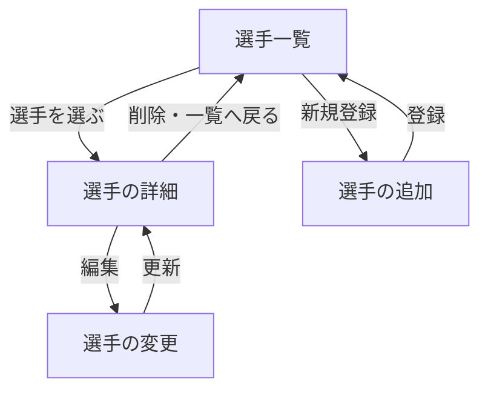
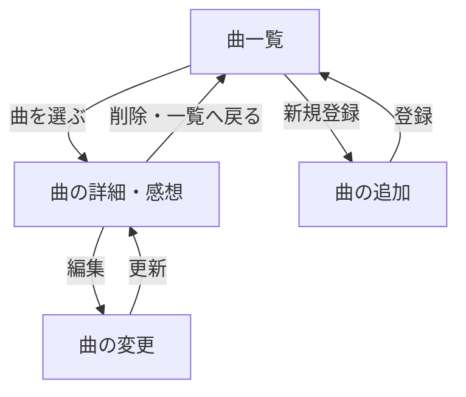

# レポート用アプリの設計案

## 共通の方針

一覧から詳細を見られるアプリを3つ作る。各アプリでデータの一覧・詳細表示、追加、変更、削除を行う。データは変数に記録する。JavaScriptファイルの先頭には `"use strict";` を付ける。

### 共通のURLと操作

サッカー選手管理は `/players`、課題管理は `/tasks`、好きな曲管理は `/songs` を使う。3つのアプリでURLの形をそろえ、登録・変更・削除はフォームから送信する。

| 操作 | メソッド | URL |
|---|---|---|
| 一覧を表示 | GET | `/{resource}` |
| 詳細を表示 | GET | `/{resource}/{id}` |
| 追加画面を表示 | GET | `/{resource}/create` |
| 登録 | POST | `/{resource}` |
| 変更画面を表示 | GET | `/{resource}/edit/{id}` |
| 更新 | POST | `/{resource}/update/{id}` |
| 削除 | POST | `/{resource}/delete/{id}` |

`{resource}` は `players`、`tasks`、`songs` のいずれか。登録・削除の後は一覧に、更新の後は詳細に戻る。

## 1. サッカー選手管理

選手を登録し、所属チームやポジションを一覧・詳細で確認する。

### 画面の流れ

### データ項目

| 項目 | 型 | 内容 |
|---|---|---|
| id | 数値 | 選手を区別する番号 |
| name | 文字列 | 選手名 |
| team | 文字列 | 所属チーム |
| position | 文字列 | ポジション |
| number | 数値 | 背番号 |

## 2. 課題管理

授業の課題を登録し、期限と進捗を一覧・詳細で確認する。

### 画面の流れ

### データ項目

| 項目 | 型 | 内容 |
|---|---|---|
| id | 数値 | 課題を区別する番号 |
| title | 文字列 | 課題名 |
| subject | 文字列 | 授業名 |
| dueDate | 文字列 | 提出期限 |
| status | 文字列 | 未着手・進行中・完了 |

## 3. 好きな曲管理

好きな曲を登録し、アーティストやアルバムを一覧・詳細で確認する。曲ごとに感想を1つ書けるようにし、追加・変更画面で入力、詳細画面で表示する。

### 画面の流れ

### データ項目

| 項目 | 型 | 内容 |
|---|---|---|
| id | 数値 | 曲を区別する番号 |
| title | 文字列 | 曲名 |
| artist | 文字列 | アーティスト名 |
| album | 文字列 | アルバム名 |
| genre | 文字列 | ジャンル |
| impression | 文字列 | 曲ごとの感想（1つ） |
