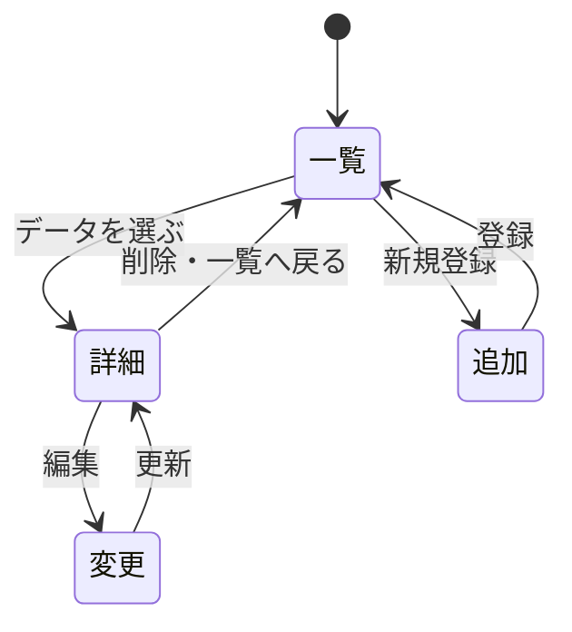

# レポート用アプリの設計案

## 共通の方針

一覧から詳細を見られるアプリを3つ作る。各アプリでデータの一覧・詳細表示、追加、変更、削除を行う。データは変数に記録する。JavaScriptファイルの先頭には `"use strict";` を付ける。

ページの流れは、一覧から詳細・追加画面へ進み、詳細から変更・削除を行った後に一覧へ戻る。

## 1. サッカー選手管理

選手を登録し、所属チームやポジションを一覧・詳細で確認する。

| 項目 | 型 | 内容 |
|---|---|---|
| id | 数値 | 選手を区別する番号 |
| name | 文字列 | 選手名 |
| team | 文字列 | 所属チーム |
| position | 文字列 | ポジション |
| number | 数値 | 背番号 |

## 2. 課題管理

授業の課題を登録し、期限と進捗を一覧・詳細で確認する。

| 項目 | 型 | 内容 |
|---|---|---|
| id | 数値 | 課題を区別する番号 |
| title | 文字列 | 課題名 |
| subject | 文字列 | 授業名 |
| dueDate | 文字列 | 提出期限 |
| status | 文字列 | 未着手・進行中・完了 |

## 3. 好きな曲管理

好きな曲を登録し、アーティストやアルバムを一覧・詳細で確認する。

| 項目 | 型 | 内容 |
|---|---|---|
| id | 数値 | 曲を区別する番号 |
| title | 文字列 | 曲名 |
| artist | 文字列 | アーティスト名 |
| album | 文字列 | アルバム名 |
| genre | 文字列 | ジャンル |

## 今後の仕様書

利用者向け・管理者向け・開発者向けの3部構成でMarkdownにまとめる。ソースコードはGitHubに置き、仕様書にURLを記載する。授業で説明されていない技術を使用する場合は、概要と採用理由を記載する。
