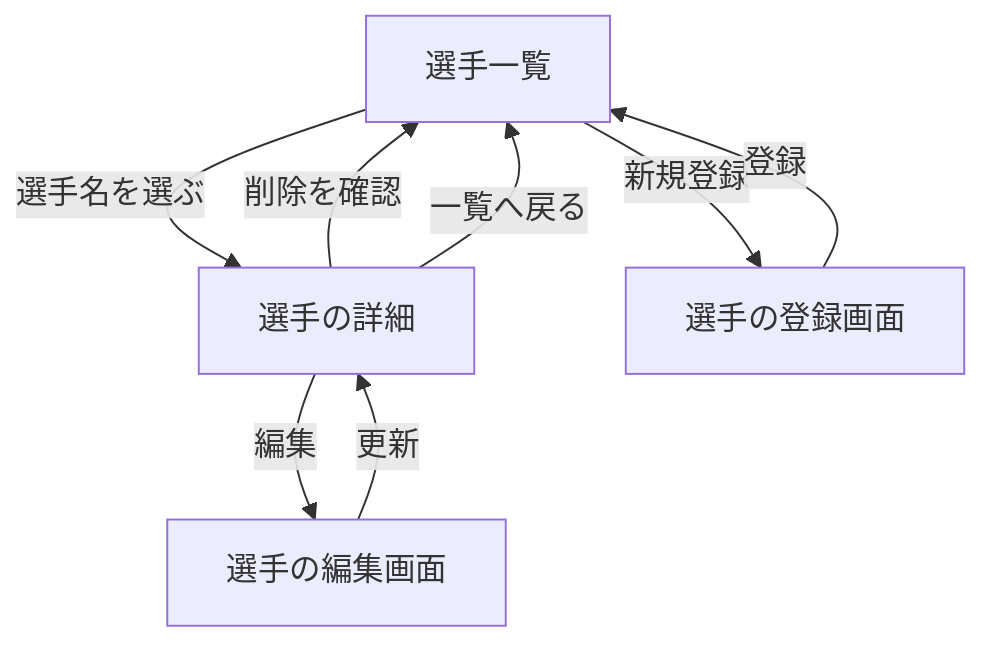
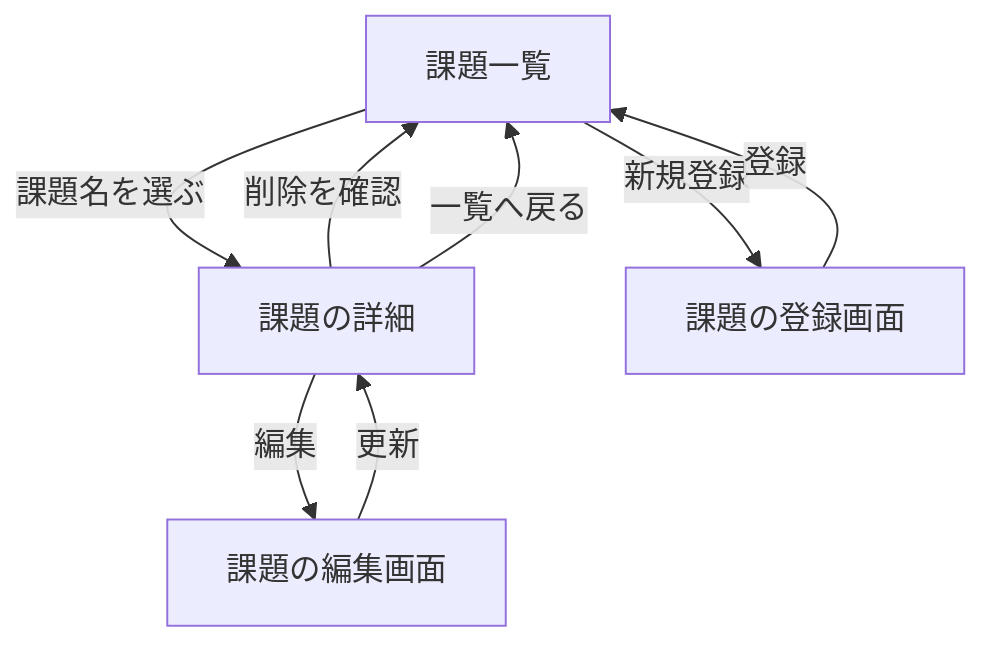
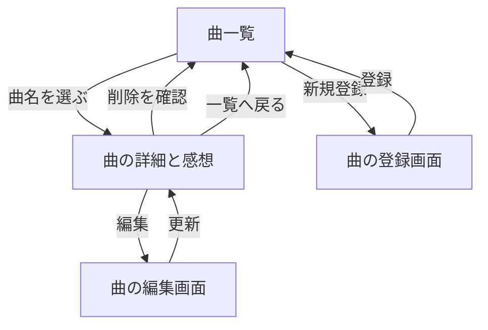

# Webプログラミング 仕様書

サッカー選手管理、課題管理、好きな曲管理の3つを作成した。共通の入口は `/report` とする。各アプリで一覧表示、詳細表示、新規登録、編集、削除ができる。

ソースコードと仕様書は [GitHubの授業用リポジトリ](https://github.com/Mochi17-bot/webpro_06/tree/main) に置く。

## 1. 利用者向け

代表として課題管理の操作を説明する。ブラウザで [アプリ一覧](http://localhost:8080/report) を開き、「課題管理」を選ぶ。一覧に課題名、授業名、提出期限、進捗が表示される。

1. 「新規登録」を開き、課題名、授業名、提出期限、進捗を入力して「登録」を押す。課題が一覧に加わる。
2. 一覧にある課題名をクリックすると詳細が表示される。
3. 詳細から「編集」を選ぶ。例えば進捗を「完了」に変更して「更新」を押すと、更新後の詳細が表示される。
4. 詳細の「削除」を押し、確認画面で承認すると削除されて一覧へ戻る。キャンセルすると詳細画面にとどまる。

サッカー選手管理と好きな曲管理も同じ手順で操作できる。好きな曲管理では、登録・編集画面で曲ごとに感想を1つ入力できる。感想は曲の詳細に表示される。

## 2. 管理者向け

Node.js と npm を用意し、リポジトリのフォルダで次を実行する。

```sh
npm ci
node app5.js
```

ブラウザで [アプリ一覧](http://localhost:8080/report) を開く。8080番ポートを別のサーバーが使用中なら `PORT=8081 node app5.js` で起動し、URLのポート番号にも8081を指定する。サーバーは起動したターミナルで Control+C を押すと停止する。

3つのアプリは1つのサーバーで動作する。データはアプリごとの配列に保存される。初期データは操作を試すためのサンプルで、課題の期限も架空の例である。サーバーを再起動すると、登録・変更・削除の結果は消え、初期データに戻る。授業用のローカル利用を想定しており、アプリの操作画面は共通でログインは不要。

## 3. 開発者向け

`app5.js` でExpressを起動し、`report-apps.js` で3つのアプリの項目、データ、URLを定義する。画面は `views/report_index.ejs`、`views/report_list.ejs`、`views/report_detail.ejs`、`views/report_form.ejs` で描画する。今回の処理を置くJavaScriptファイルは先頭で `"use strict";` を指定する。

`{resource}` は `players`、`tasks`、`songs` のいずれかで、`{id}` はレコードごとに自動採番する。次のURLの形と操作後の画面を3つでそろえる。

| 操作 | メソッド | URL | 結果 |
|---|---|---|---|
| 一覧 | GET | `/{resource}` | 一覧を表示 |
| 詳細 | GET | `/{resource}/{id}` | 指定したデータの詳細を表示 |
| 新規登録画面 | GET | `/{resource}/create` | 空のフォームを表示 |
| 登録 | POST | `/{resource}` | 配列に追加し、一覧へ戻る |
| 編集画面 | GET | `/{resource}/edit/{id}` | 現在の値を入れたフォームを表示 |
| 更新 | POST | `/{resource}/update/{id}` | 配列の該当データを更新し、詳細へ戻る |
| 削除 | POST | `/{resource}/delete/{id}` | 配列から該当データを削除し、一覧へ戻る |

入力エラーはHTTP 400でフォームと理由を表示する。存在しないIDはHTTP 404を返す。登録・更新・削除の後にはHTTP 303で画面に戻る。ブラウザが次の画面をGETで開くため、成功画面を再読み込みしてもフォームが再送信されない。削除時はブラウザ標準のJavaScript関数 `confirm()` で確認を表示し、押し間違いによる削除を防ぐ。ExpressとEJSは授業例と同じもので、追加のライブラリは使っていない。

### 3.1 サッカー選手管理

入口は `/players`。選手名、所属チーム、ポジション、背番号を一覧と詳細に表示する。

| データ項目 | 型 | 入力条件 |
|---|---|---|
| `id` | 数値 | 自動採番 |
| `name` | 文字列 | 選手名。必須 |
| `team` | 文字列 | 所属チーム。必須 |
| `position` | 文字列 | ポジション。必須 |
| `number` | 数値 | 背番号。0以上の整数。必須 |



### 3.2 課題管理

入口は `/tasks`。課題名、授業名、提出期限、進捗を一覧と詳細に表示する。進捗は選択欄から変更する。

| データ項目 | 型 | 入力条件 |
|---|---|---|
| `id` | 数値 | 自動採番 |
| `title` | 文字列 | 課題名。必須 |
| `subject` | 文字列 | 授業名。必須 |
| `dueDate` | 文字列 | 提出期限。実在する日付を `YYYY-MM-DD` で保存。必須 |
| `status` | 文字列 | 未着手・進行中・完了のいずれか。必須 |



### 3.3 好きな曲管理

入口は `/songs`。曲名、アーティスト名、アルバム名、ジャンルを一覧に表示する。詳細には曲ごとの感想を加えて表示する。感想は登録・編集時に複数行で入力できる。

| データ項目 | 型 | 入力条件 |
|---|---|---|
| `id` | 数値 | 自動採番 |
| `title` | 文字列 | 曲名。必須 |
| `artist` | 文字列 | アーティスト名。必須 |
| `album` | 文字列 | アルバム名。任意 |
| `genre` | 文字列 | ジャンル。任意 |
| `impression` | 文字列 | 曲ごとの感想を1つ記録。任意 |


