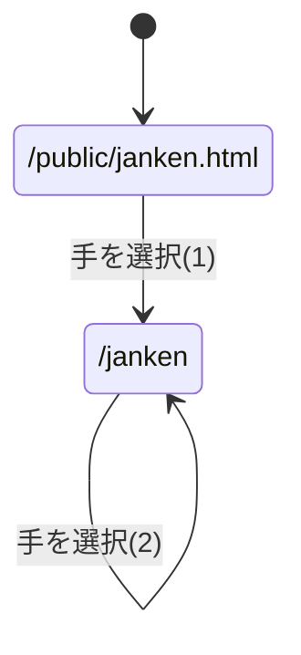
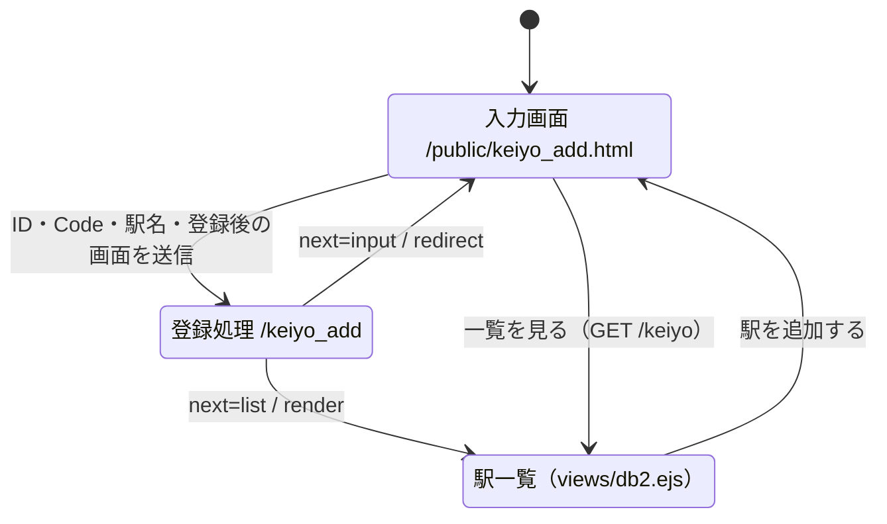

# webpro_06のページ遷移図

### じゃんけん関係
#### ページ遷移図

#### (1)のパラメータ

パラメータ名 | 属性 | 内容 | 値
-|-|-|-
hand | text | ユーザの手 | グー/チョキ/パー
win | hidden | 勝利数 | 0
total | hidden | 対戦数 | 0

#### (2)のパラメータ

パラメータ名 | 属性 | 内容 | 値
-|-|-|-
hand | text | ユーザの手 | グー/チョキ/パー
win | hidden | 勝利数 | これまでの勝利数
total | hidden | 対戦数 | これまでの対戦数

### 京葉線の駅データ追加（スライド30ページ (1)）

入力画面 `/public/keiyo_add.html` の「登録後の画面」で、次の2通りを比較できる。

| 登録後の画面 | 処理 | 向いている使い方 |
|---|---|---|
| データ一覧（初期選択） | `res.render('db2', { data: station })` | 追加した駅が一覧に反映されたか確認する |
| データ入力 | `res.redirect('/public/keiyo_add.html')` | 空のフォームに戻り、続けて駅を登録する |

登録結果をすぐ確認できる一覧表示を初期選択にした。どちらの画面にも一覧・入力を行き来するリンクを置いた。

#### ページ遷移図

スライドの例に合わせてGETで登録し、データはサーバーのメモリ上の配列に追加する。
一覧を直接renderした後のURLで再読み込みすると同じ駅が再登録されるため、再表示には登録用URLではなく `/keiyo` を開く。
サーバーを再起動すると追加データは消え、初期の6駅に戻る。
